# RoboMaster 视觉培训：第三部分

> 主题：从相机观测到云台命令，理解一套视觉系统中的坐标、几何与通信关系。
>
> 前置要求：能够使用 OpenCV 读取图片或视频，并完成基础目标检测，得到目标区域或图像中心点。


# 前言
本文涉及部分线性代数知识，未学习过的同学可以跳过线代部分或者自行查阅相关资料。对线性代数感兴趣的同学可以查看这个链接，该系列视频对于理解和学习线性代数很有帮助：【熟肉】线性代数的本质 - 00 - “线性代数的本质”系列预览】https://www.bilibili.com/video/BV1rs411k7ru?vd_source=21c88c1b039f17f62450f52c71d0c27e

本文文字量较大，内容覆盖较多，可能需要较长的时间阅读与理解

第三部分不把相机、标定、PnP、云台和串口当作互不相关的知识点，而是围绕同一个问题展开：**相机看到的目标，如何变成下位机能够执行的云台指令？**

```text
场景中的目标继续
   ↓ 相机成像
像素坐标中的目标观测与角点
   ↓ 已知目标几何 + 相机内参与畸变模型
相机坐标系中的目标位置/姿态（PnP）
   ↓ 相机与云台之间的坐标变换
云台坐标系中的目标方向
   ↓ 结合当前云台角度、控制策略和安全限制
目标 yaw / pitch 命令
   ↓ 按通信协议打包
串口字节流 -> 下位机解析 -> 云台执行
```

这些知识点的作用各不相同：标定说明相机怎样成像；PnP根据已知目标尺寸得到目标相对相机的姿态；坐标变换把同一个目标从一个参考系表达成另一个参考系；控制决定云台下一步如何运动；通信协议协议负责可靠地传递命令和接受反馈。将他们与USB相机和云台组合到一起，我们将得到一个简易自瞄装置。


## 为什么要学习坐标变换

机器视觉的本质，是通过二维图像去理解和测量三维世界。这个过程可以理解成“翻译”：相机、图像处理程序、云台和场地分别使用不同的坐标语言，必须按照明确的规则转换，才能让一个目标在不同模块中仍然指向同一个物理位置。

例如，检测器只能告诉我们“目标位于第几列、第几行像素”；云台需要知道“目标相对于转轴在左边还是右边、上方还是下方”；如果还要做场地定位，则需要知道“目标在场地的什么位置”。它们属于不同坐标系，不能直接把数值复制到下一个模块。

本章后续内容可以先用下面的关系建立整体认识：

```text
场景中的三维点
  -> 世界/目标坐标系中的坐标
  -> 通过外参变换到相机坐标系
  -> 通过小孔成像模型投影到图像平面
  -> 通过内参映射到像素坐标
  -> 由图像检测得到像素观测
```

从三维到二维的投影会丢失深度，因此反向从像素恢复三维位置时必须加入额外约束。已知目标尺寸时可以使用 PnP；有两个观察角度时可以使用双目；有深度传感器时可以直接读取深度。没有这些约束时，一个像素只能对应相机前方的一条空间射线。

## 1. 坐标系：同一个目标可以有不同坐标

> **学习层级**
>
> - 必须掌握：坐标值必须连同坐标系一起理解；像素、毫米、米和角度不能混用。
> - 需要理解：不同坐标系间通过旋转和平移描述同一个物理点。
> - 暂不要求：完整机器人运动学推导和多传感器融合。

坐标不是物体自带的标签，而是“相对于某个参考原点和坐标轴”的描述。同一个目标，在相机坐标系中可能是 `(0.2, 0.1, 3.0) m`，在云台坐标系中则是另一个三维数值。它们描述的是同一个目标，只是参考点和坐标轴不同。

### 1.1 本文使用的坐标系

| 坐标系 | 原点与维度 | 常见单位 | 主要用途 |
| --- | --- | --- | --- |
| 世界坐标系 `W` | 场地或机器人选定的全局参考点，三维 | m 或 mm | 描述场地中机器人、目标的全局位置；用于定位、导航或跨帧地图关系 |
| 云台基座坐标系 `G` | 云台机械基座或约定的转轴参考点，三维 | m 或 mm | 把目标方向转换成云台所需的 yaw、pitch 方向 |
| 相机坐标系 `C` | 相机光心，三维 | m 或 mm | 描述目标相对相机的位置；PnP 的平移结果通常在这里表达 |
| 目标坐标系 `T` | 目标模型上约定的原点，三维 | m 或 mm | 描述目标已知角点或几何尺寸，作为 PnP 的模型坐标 |
| 图像平面坐标系 `I` | 光轴与理想成像平面的交点，二维 | mm | 描述像点在成像平面上的物理位置；常见于相机投影模型的推导 |
| 像素坐标系 `P` | 图像左上角，二维 | pixel | OpenCV 检测点、框和中心点通常使用的坐标 |

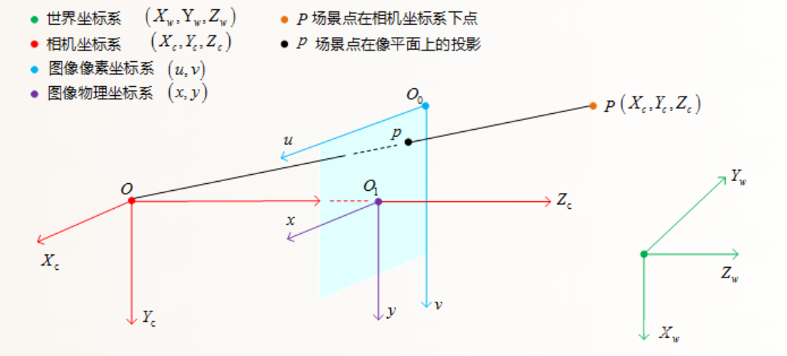

图像平面坐标和像素坐标都在二维图像上，但单位不同。前者可以用毫米表达传感器上的位置，后者用像素表达离散图像中的位置。OpenCV 程序里的 `(u, v)` 通常是像素坐标，不是毫米。像素坐标原点在左上角，`u` 向右增加、`v` 向下增加。下图为像素坐标系其x，y对应u和v。

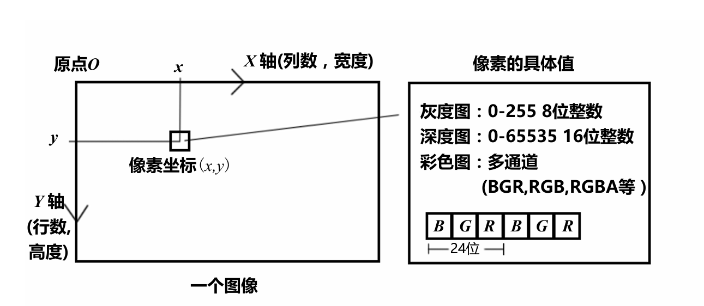

若图像平面物理坐标记为 `(x_I, y_I)`，传感器的像素密度分别为 `s_x`、`s_y` 像素/毫米，主点为 `(c_x, c_y)`，常见映射可写为：

```text
u = s_x x_I + c_x
v = s_y y_I + c_y
```

具体正负号取决于图像平面坐标轴如何定义；进入 OpenCV 后，最终统一到 `u` 向右、`v` 向下的像素约定。`(x_I, y_I)` 是物理长度，`(u, v)` 是像素索引，不能直接互换。


还要区分“图像坐标系”和“像素坐标系”这两个说法在不同资料里的用法。有些资料会把像素坐标也简称图像坐标。本文为了避免歧义，将传感器上的物理平面称为 `I`，以像素为单位、左上角为原点的离散坐标称为 `P`。

### 1.2 相机坐标系与世界坐标系

相机坐标系的原点位于相机光心。本文采用 OpenCV 常见约定：`+X_C` 指向图像右侧，`+Y_C` 指向图像下方，`+Z_C` 沿光轴指向相机前方。相机看到的目标若在正前方，通常有 `Z_C > 0`。

世界坐标系则由使用者在场景中定义。它的原点可以放在场地某个角点、机器人初始位置或地图参考点，关键是整个系统都遵守同一套原点、轴向和单位。世界坐标系不是相机天然提供的；单目相机只看见图像时，并不知道自己在场地的绝对位置。

若相机在世界中的位置和姿态已知，就可以通过刚体变换把相机坐标变换到世界坐标。刚体变换只改变物体的空间位置(平移)和朝向(旋转)，而不改变其形状的变换（一种记忆方法，硬的东西：比如石头，你不能改变他的形状，只能把它旋转或者平移），可用两个变量来描述：正交单位旋转矩阵R，三维平移矢量T。若不知道相机在世界中的位姿，即使得到了目标相对相机的位置，也不能凭空得到目标的全局位置。下图中O_c为相机坐标系原点，O_w为世界坐标系原点。

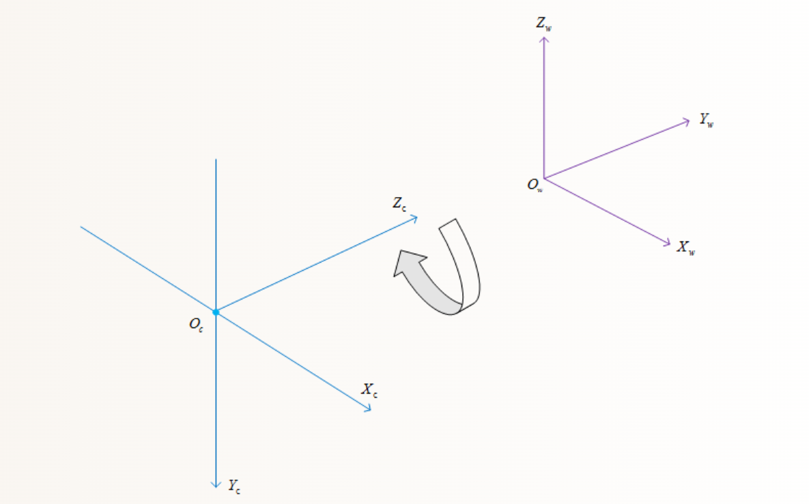

### 1.3 姿态表示：欧拉角（yaw、pitch、roll）与四元数

先区分概念：**欧拉角是一类用三个角表示三维姿态的方法；yaw、pitch、roll 是这三个角的常见名称。**在机器人和云台资料中，人们常把这种表示简称为“yaw-pitch-roll”。所以 yaw、pitch、roll 并不是欧拉角之外的另一组量。

三个角的直观含义如下：

| 名称 | 中文 | 直观运动 |
| --- | --- | --- |
| yaw | 偏航角 | 水平转向，改变前进方向 |
| pitch | 俯仰角 | 抬头或低头，改变俯仰程度 |
| roll | 横滚角 | 在机体坐标中绕前向轴侧倾；在相机坐标中常表现为图像绕光轴转动，改变倾斜程度 |

下图分别为yaw，pitch，roll旋转示意图

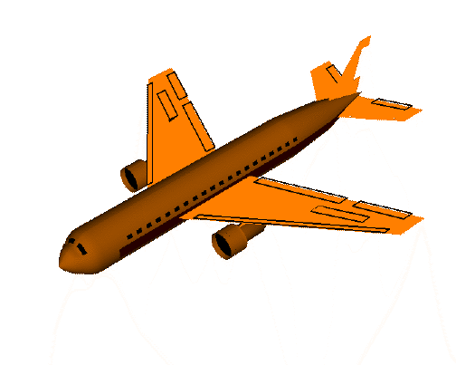

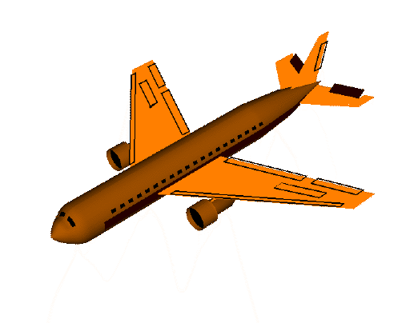

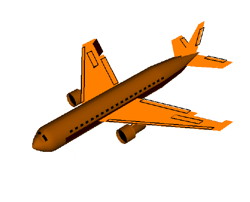

这些名称只说明转动的大致含义，**还不足以唯一确定姿态**。还必须说明所用坐标系、绕哪些轴旋转、旋转正方向，以及三个旋转的组合顺序。例如，本文为便于说明采用右手机体坐标系 `X` 向前、`Y` 向左、`Z` 向上，并使用 `Z-Y-X`（yaw-pitch-roll）约定：先绕固定的 `Z` 轴转 yaw，再绕已经转动后的 `Y` 轴转 pitch，最后绕再次转动后的 `X` 轴转 roll。用旋转矩阵合成时写作：

```text
R = Rz(yaw) Ry(pitch) Rx(roll)
```

矩阵作用在列向量上时，最右侧的 `Rx` 最先作用于向量；这与“依次绕当前机体轴进行 yaw、pitch、roll”的旋转说法等价。改变为绕固定坐标轴旋转，或改变轴顺序，都会改变最终姿态；其他资料若采用不同约定，角度数值不能直接比较。

本文默认使用右手系。判断绕某根轴的正旋转方向时，将右手大拇指指向该轴正方向，四指弯曲的方向就是正旋转方向。在上述 `X` 前、`Y` 左、`Z` 上的约定中，正 yaw 绕 `+Z` 轴按右手规则确定；正 pitch、正 roll 也分别按 `+Y`、`+X` 轴确定。某些设备或协议会采用相反的电机正方向，必须通过轴定义和实测建立映射，不能只看变量名。

两轴云台的 yaw 轴和 pitch 轴是实际机械关节；yaw、pitch、roll 作为一组欧拉角则是描述整体姿态的数学参数。两者在简单云台上常有直观对应，但不是同一个概念。简易两轴云台通常没有主动 roll 关节，不过相机安装倾斜仍会影响测量和坐标变换。

#### 欧拉角的万向节锁

在上面选定的 `Z-Y-X` 欧拉角约定中，当中间的 pitch 接近 `+90°` 或 `-90°` 时，前后两个旋转轴可能重合，使一个转动自由度无法再被独立区分，这称为万向节锁（gimbal lock）。它不是任意一个轴转到 `90°` 都会发生，也不是物体真的失去了运动能力，而是这组欧拉角参数在特定姿态附近出现表示奇异性。换用不同欧拉角顺序，奇异姿态的位置也会改变。想要进一步了解万向节死锁问题的同学可以阅读以下链接https://blog.csdn.net/GHENYOUJIAN/article/details/142154282

#### 四元数的作用

四元数通常写成 `(w, x, y, z)`。它用四个数表示旋转，并满足单位长度约束，因此仍表示三个自由度。四元数不需要把姿态拆成三个依次旋转的角，在连续姿态更新、旋转组合和姿态插值时可以避开欧拉角的万向节锁表示奇异性。四元数不能消除机械结构真实存在的轴锁死，也不能让不同坐标约定自动一致；使用时仍要明确它表示哪个坐标系到哪个坐标系的旋转。由于四元数涉及复杂的数学知识与4维空间，这里并不详细讲解，感兴趣的同学可以查看这个链接：【四元数的可视化】https://www.bilibili.com/video/BV1SW411y7W1?vd_source=21c88c1b039f17f62450f52c71d0c27e

OpenCV `solvePnP` 返回的是 Rodrigues 旋转向量 `rvec`，不是欧拉角，也不是四元数。若要得到 yaw、pitch、roll 或四元数，应先把 `rvec` 转成旋转矩阵，再根据已约定坐标系顺序转换。不能直接把 `rvec` 的三个分量当成 yaw、pitch、roll。

Rodrigues 旋转向量把旋转轴和旋转角压在三个分量中：向量方向表示旋转轴，向量长度表示旋转角（弧度）。它的表示紧凑，但三个分量不是分别绕 X、Y、Z 的旋转角。OpenCV 的 `cv::Rodrigues` 可以在旋转向量与旋转矩阵之间转换。得到矩阵后，若按本节约定的 `R = Rz(yaw) Ry(pitch) Rx(roll)` 提取欧拉角，在非奇异姿态下可使用：

```cpp
cv::Mat rotation_matrix;
cv::Rodrigues(rvec, rotation_matrix);
```


```text
yaw   = atan2(R[2,1], R[1,1])
pitch = atan2(-R[3,1], sqrt(R[1,1]^2 + R[2,1]^2))
roll  = atan2(R[3,2], R[3,3])
```

这里矩阵下标按从 1 开始的数学记法书写；C++ 的 `R.at<double>(row, col)` 下标从 0 开始。接近万向节锁时，上述欧拉角分解会变得不稳定，此时应优先保留旋转矩阵或使用四元数表达姿态。

### 1.4 用变换矩阵连接坐标系


设 `p_B` 是一个点在坐标系 `B` 中的坐标，`p_A` 是同一个点在坐标系 `A` 中的坐标。用 `T_AB` 表示“把 `B` 系坐标变换成 `A` 系坐标”：

```text
p_A = R_AB p_B + t_AB

         [ R_AB  t_AB ]
T_AB =  [  0 0 0   1  ]
```

这里 `R_AB` 描述两个坐标系的轴向旋转关系，即旋转矩阵，`t_AB` 描述 `B` 系原点在 `A` 系中的位置，即平移矩阵。变换下标从右向左读：`T_AB` 作用于 `p_B`，得到 `p_A`。平移和点坐标必须使用同一长度单位。

若目标点先从目标坐标系变到相机坐标系，再从相机变到云台基座坐标系，链式关系是：

```text
p_G = T_GC T_CT p_T
```

如果目标坐标系 `T` 被定义为场景的世界坐标系 `W`，则同一条关系也可以写成：

```text
p_C = T_CW p_W
```

这正是 PnP 常见的输出形式：给定世界/目标坐标系中的已知三维点和图像中的对应像素点，求出 `T_CW`，使世界点能够转换到相机坐标系。OpenCV 的 `solvePnP` 返回的 `rvec`、`tvec` 默认表达的是“目标（或世界）到相机”的变换；如果要得到“相机在世界中的位姿”，还要对这个变换求逆。只有在已经定义了可靠的世界坐标系时，才可以把目标坐标系称为世界坐标系；RM 中使用装甲板尺寸建立的通常是局部目标坐标系。后续内容会详细讲解pnp算法。

完整的理想投影链可以写成：

```text
s [u, v, 1]^T = K T_CW [X_W, Y_W, Z_W, 1]^T
```


其中 `T_CW` 负责把世界/目标坐标变到相机坐标，`K` 负责把归一化成像坐标变成像素坐标，`s` 是由深度产生的尺度因子。真实镜头存在畸变时，还要在投影或反投影过程中使用畸变参数；上式表示的是理想针孔模型。

矩阵相乘顺序不可随意交换。实际项目中还可能有云台关节坐标系；相机装在会转动的云台上时，相机到云台基座的变换会依赖当前关节角度，不一定是常量。

举一个只为说明计算顺序的例子：相机和云台轴向平行，相机光心位于云台原点右侧 `20 mm`、前方 `30 mm`，所以 `R_GC = I`、`t_GC = (20, 0, 30) mm`。相机测得目标点 `p_C = (100, -50, 1000) mm`，则：

```text
p_G = R_GC p_C + t_GC
    = (100, -50, 1000) + (20, 0, 30)
    = (120, -50, 1030) mm
```
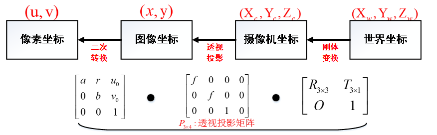  
坐标变换只是改变同一目标的位置表达，不会移动目标本身。若坐标轴不平行，还要先应用旋转 `R_GC`，再加平移。


## 2. USB 相机与 UVC：得到稳定、可解释的图像

> **学习层级**
>
> - 必须掌握：OpenCV 打开相机、读取有效帧、检查实际分辨率和帧率。
> - 需要理解：曝光时间、增益、Gamma、白平衡对图像和检测稳定性的影响。
> - 暂不要求：工业相机 SDK、多线程采集队列和硬件触发。

UVC（USB Video Class）是常见 USB 摄像头使用的设备类别。在 Ubuntu 中，相机通常由 V4L2 驱动暴露为 `/dev/video0` 等设备节点。OpenCV 的 `VideoCapture` 可以通过设备编号打开相机并读取 `cv::Mat` 图像。

### 2.1 检查设备与支持的模式

```bash
sudo apt install v4l-utils
v4l2-ctl --list-devices
v4l2-ctl -d /dev/video0 --list-formats-ext
v4l2-ctl -d /dev/video0 --list-ctrls-menus
```

| 命令 | 用途 |
| --- | --- |
| `v4l2-ctl --list-devices` | 查看相机对应哪个 `/dev/videoX` 节点 |
| `--list-formats-ext` | 查看设备支持的像素格式、分辨率和帧率组合 |
| `--list-ctrls-menus` | 查看曝光、增益、Gamma、白平衡等控制项及其范围 |

一个物理相机可能提供多个 `/dev/videoX` 节点；设备编号在拔插或重启后也可能变化。相机能被系统列出，不代表指定分辨率和帧率一定可用，应以程序实际读到的画面和参数为准。

### 2.2 用 OpenCV 读取实时图像

```cpp
cv::VideoCapture cap(0, cv::CAP_V4L2);
if (!cap.isOpened()) {
    // 相机未打开：检查设备编号、虚拟机 USB 透传和权限
}

cap.set(cv::CAP_PROP_FRAME_WIDTH, 1280);
cap.set(cv::CAP_PROP_FRAME_HEIGHT, 720);
cap.set(cv::CAP_PROP_FPS, 30);

cv::Mat frame;
if (!cap.read(frame) || frame.empty()) {
    // 本次没有得到有效帧
}
```

这是取流结构示意片段，省略了窗口显示、退出处理和资源管理。`cap.set` 是向驱动请求参数，不保证设备一定接受；读取 `cap.get` 或直接测量实际帧率，才能知道最后采用了什么模式。OpenCV 属性与具体相机、驱动和后端有关，某些属性可能不支持或不能稳定设置。

实时图像还有时间属性。若相机输出 30 fps，理论帧间隔约为 33 ms；若检测和通信每帧总共耗时 60 ms，程序就不可能稳定处理每一帧。调试时应记录处理耗时和帧率，避免把旧帧的目标位置当成当前时刻的位置。

OpenCV 也提供 `CAP_PROP_EXPOSURE`、`CAP_PROP_GAIN`、`CAP_PROP_GAMMA`、`CAP_PROP_AUTO_EXPOSURE` 等属性，可通过 `cap.set(property, value)` 请求设置，再用 `cap.get(property)` 查看后端返回值：

```cpp
cap.set(cv::CAP_PROP_AUTO_EXPOSURE, auto_exposure_value);  //设置是否开启自动曝光
cap.set(cv::CAP_PROP_EXPOSURE, exposure_value); //设置曝光时间
cap.set(cv::CAP_PROP_GAIN, gain_value);  //设置增益
cap.set(cv::CAP_PROP_GAMMA, gamma_value);  //设置gamma
```

属性是否生效、取值含义和数值范围取决于 UVC 相机、驱动及 OpenCV 后端；Linux 下应以 `v4l2-ctl --list-ctrls-menus` 显示的设备能力为准。`cap.get` 返回值也不一定代表传感器当前的真实控制量，必要时应再次查询 V4L2 并观察图像变化。

### 2.3 曝光、增益与 Gamma

相机参数会改变图像，而图像变化又会影响阈值、边缘、角点和 PnP 结果。调参不是把画面调得“看起来漂亮”，而是找到一组稳定、可重复的成像条件。

| 参数 | 通俗解释 | 调大后的常见影响 | 对视觉算法的影响 |
| --- | --- | --- | --- |
| 曝光时间（Exposure） | 传感器接收光线的时间 | 画面变亮；运动目标更容易拖影 | 亮度阈值可能变化，角点变模糊，定位误差增大 |
| 增益（Gain） | 把传感器输出信号放大 | 画面变亮，但噪声也被放大 | 细小噪点增加，分割区域和边缘可能变得不稳定 |
| Gamma | 非线性调整暗部、中间调和亮部的灰度关系 | 视觉观感和局部灰度对比发生变化 | 阈值、梯度和灰度测量受影响，数据不再是原始线性亮度关系 |
| 白平衡（White Balance） | 调整不同颜色通道的增益，使中性物体接近白色 | 红、绿、蓝通道比例变化 | 基于颜色的分割边界可能漂移 |
| 对焦（Focus） | 调整成像清晰位置 | 目标边缘更清楚或更模糊 | 模糊会直接影响灯条边缘、角点和 PnP |

增益可以理解为把传感器收到的信号再放大。它见效快，但有用信号与噪声都会一起放大。曝光时间控制传感器接收光的时长：时间越长通常越亮，但高速运动物体容易产生拖影。Gamma 重新分配暗部、中间调和亮部的灰度关系；它可能让暗部看起来更清楚，也可能改变边缘两侧的灰度差。因此 Gamma 更适合在明确知道算法需要、且能重复验证时使用，不应为了“画面更好看”随意调整。

建议按以下顺序调试：先固定分辨率、帧率、焦距和相机安装；然后保证曝光足够短、运动边缘不明显拖影；再把增益降到满足亮度的较低水平；固定白平衡；最后只有在确有需要时再调整 Gamma。每次只改一个参数，并同时观察原图、阈值图、目标框和角点，不要一次改变多个参数后猜测原因。

UVC 相机拔插或重启后可能恢复自动模式。若算法要求稳定图像，应在程序启动时重新设置相机参数，并读取或观察实际效果确认设置成功。不同设备的属性名称、数值范围和 OpenCV 后端行为可能不同；Linux 下可用 `v4l2-ctl --list-ctrls-menus` 查到设备真实支持项。下图是指令运行效果，例如图中的auto_exposure表明此相机支持自动曝光功能，值为1则是manual mode（手动模式），值为3则是自动模式

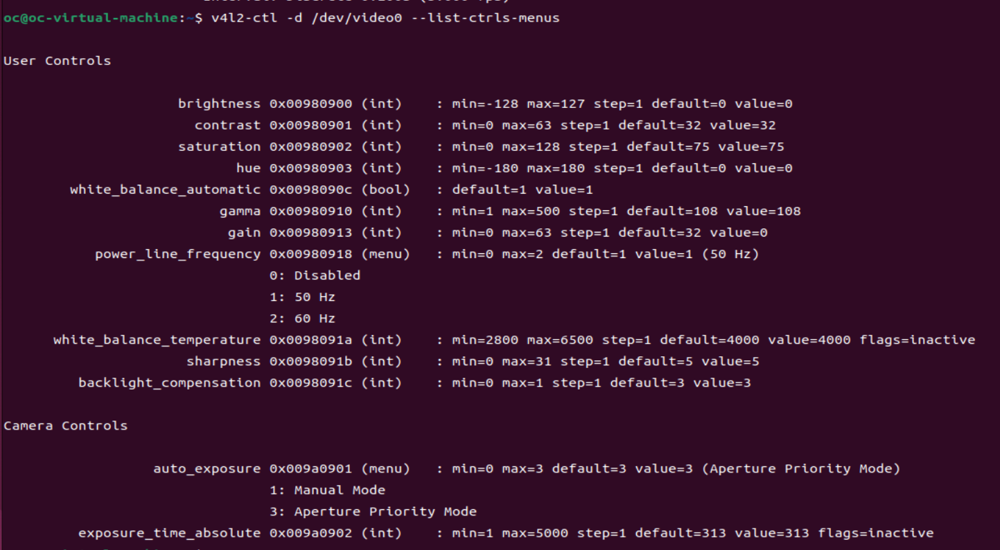

### 2.4 关于传感器

算法组致力于机器人感知周围环境，我们的工作与传感器密不可分，无论是自瞄还是导航都离不开传感器。在比赛中，我们采用工业相机作为自瞄的主传感器，哨兵额外搭载雷达（实现自主导航）与上文所介绍的uvc相机（实现全向感知）。我认为在自瞄领域来说工业相机相比uvc相机最大的优势就是帧率高，传感器的采集频率会制约算法性能的上限。我们主要使用的海康cs016-10uc工业相机最大帧率可达249.1fgs，而uvc相机帧率普遍在30-60fps之间。uvc相机又被叫做免驱相机，他的优点是不需要下载额外的驱动，即插即用。而工业相机的使用会相对复杂一些，需要下载相关产品的sdk，并根据sdk设计相应的相机类才能驱动工业相机完成取图等功能。关于工业相机的使用这里并不详细讲述，感兴趣的同学可以自行查阅相关资料。


## 3. 相机标定：建立像素与相机几何的对应关系

> **学习层级**
>
> - 必须掌握：内参、畸变、标定板、重投影误差分别表示什么。
> - 需要理解：标定结果依赖相机、镜头、分辨率和成像设置。
> - 暂不要求：手工推导所有畸变项或实现标定优化器。

相机拍到的像素位置不是空间坐标。要从像素推算方向或目标姿态，必须知道相机如何把空间投影到图像上。相机标定就是利用已知几何的标定板和多张图像，估计相机内参与镜头畸变参数。

### 3.1 针孔模型与内参

理想针孔模型中，相机坐标系中的三维点 `(X_C, Y_C, Z_C)` 先投影到归一化平面：

```text
x = X_C / Z_C
y = Y_C / Z_C
```

再由内参矩阵换算为像素坐标：

```text
[u]   [fx  0  cx] [x]
[v] = [ 0 fy  cy] [y]
[1]   [ 0  0   1] [1]
```

其中 `fx`、`fy` 是以像素表示的焦距，`cx`、`cy` 是主点，即光轴与成像平面的交点在像素图像中的位置。它们组成内参矩阵 `K`。镜头标注的毫米焦距不是 `fx` 或 `fy`，两者单位和含义不同。

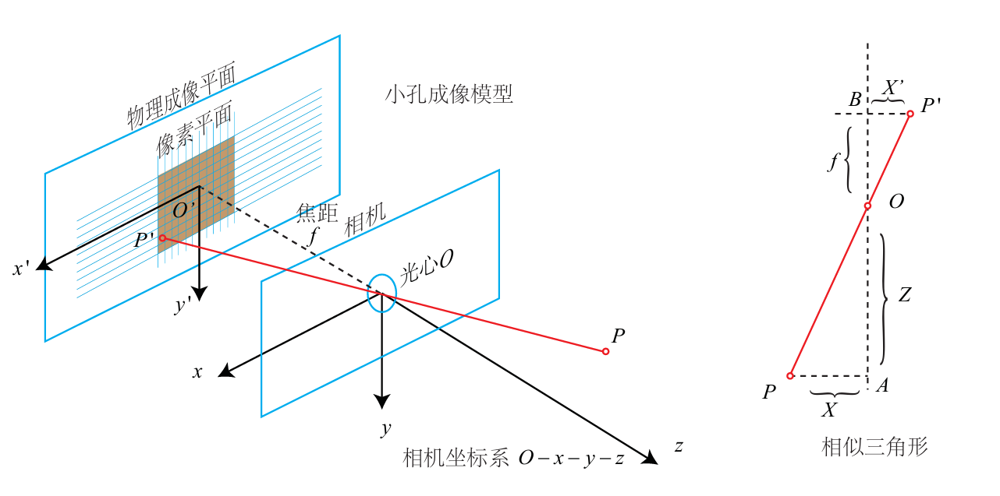

图像平面、归一化平面和像素平面是投影计算中的不同表达：先用深度把三维点变成无单位的归一化坐标，再由内参映射到像素。它们是数学转换步骤，不代表真实相机里有三个传感器平面。

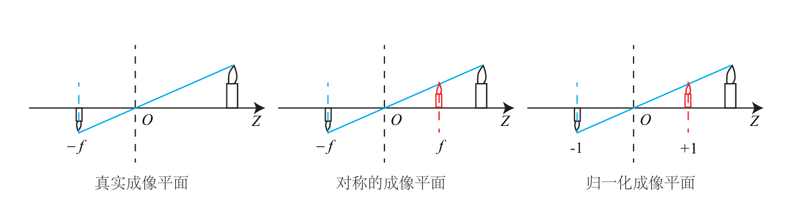

### 3.2 单目像素为什么没有深度

一个像素 `(u,v)` 在已知内参后可以反推出一条从相机光心出发的空间射线，但不能单独确定目标在射线上的距离。沿同一条射线的许多不同空间点都会投影到同一像素。

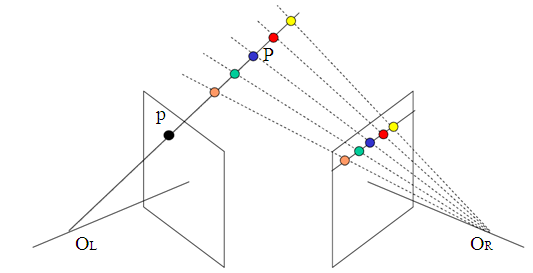

深度需要额外信息，例如双目视差、深度传感器、已知尺寸的目标模型或其他测距方法。PnP 就是利用已知目标几何尺寸和图像观测估计目标相对相机的姿态。

双目相机从两个不同位置观察同一个点，左右图像中的位置差称为视差 `d`。在双目标定和图像校正后，理想模型近似满足：

```text
Z = f b / d
```

其中 `f` 是像素单位的焦距，`b` 是两相机光心间的基线长度，`d` 是像素视差，因此 `Z` 与 `b` 使用同一长度单位。本文不要求实现双目匹配；这个关系用于说明单目缺少深度时，额外视角如何提供几何约束。


### 3.3 镜头畸变

真实镜头不完全符合针孔模型。径向畸变会使画面边缘的直线向外鼓起（桶形）或向内收缩（枕形）；切向畸变常与镜头和传感器不完全平行有关。畸变在图像中心往往较小，越靠近边缘越明显。

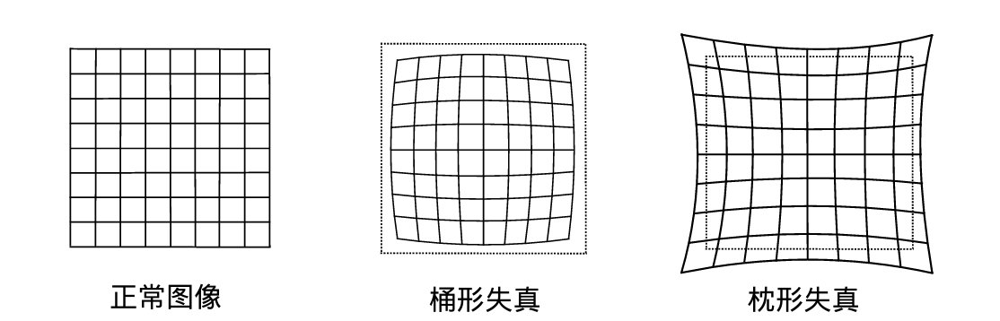

畸变参数通常记为 `distCoeffs`。它们描述镜头偏离理想投影的程度。去畸变可以把原图像素映射到更接近理想针孔模型的位置；也可以在 PnP 中直接使用畸变参数，让投影模型考虑镜头偏差。两种处理方式不能重复补偿：若输入点已经去畸变，就要按对应方式使用内参和畸变参数。

### 3.4 采集标定图像

棋盘格或圆点阵的角点/圆心在标定板坐标系中的位置已知。程序在多张不同姿态的图像中检测这些点，便得到“标定板上的已知点”与“图像中的像素点”的对应关系。

采集时应注意：

- 标定板覆盖画面中央和四周，而不只在中心；
- 应采集不同距离，不同位置，不同角度的标定板图像；
- 标定板保持平整，图像清晰，避免反光和运动模糊；
- 使用实际工作的分辨率、镜头焦距、对焦状态和安装状态；
- 确认程序使用的是内角点数量，而不是棋盘格方格数量。


如果所有图像都是同一距离、正对相机、棋盘格只在画面中央，标定数据就缺少足够变化，边缘畸变和姿态误差难以被估计。图片数量多不等于信息充分，更重要的是覆盖标定板的各种姿态。

### 3.5 OpenCV 标定流程与结果检查

```text
标定板图像
  -> 检测棋盘格角点/圆点中心
  -> 准备每个点在标定板坐标系中的位置
  -> calibrateCamera 求 K 和畸变参数
  -> 检查重投影误差与去畸变效果
  -> 保存标定结果，并在相同成像模式下使用
```

标定的核心输入是多张图像中检测到的二维像素点，以及这些点在标定板坐标系中的三维位置（平面标定板的 `Z` 通常为 0）。`cv::calibrateCamera` 输出内参、畸变参数和每张标定板相对相机的姿态估计。

```cpp
double rms = cv::calibrateCamera(
    object_points, image_points, image_size,
    camera_matrix, dist_coeffs,
    rvecs, tvecs);
```

`object_points` 是标定板上的已知点，`image_points` 是对应像素点，`image_size` 是图像宽高；`camera_matrix` 与 `dist_coeffs` 是待求结果。返回的 RMS 误差以像素为单位，表示观测点与模型投影之间的总体拟合误差。


除了看 RMS，还要检查新图像上的角点是否稳定、直线去畸变后是否合理，以及误差是否由少数模糊图片主导。标定结果必须和相机分辨率及成像裁剪方式匹配；改变分辨率、数字缩放、裁剪或镜头对焦后，应重新验证，必要时重新标定。

### 3.6 其他标定方法
标定相机内参的方法有许多，除了使用opencv自己编写代码标定以外有很多程序都有标定内参的功能，比如matlab就内置了相机标定程序，ros2同样拥有相机标定程序。但是他们的使用方法各不相同，这里不过多赘述，感兴趣的同学可以自己查阅资料。

下图为matlab标定程序

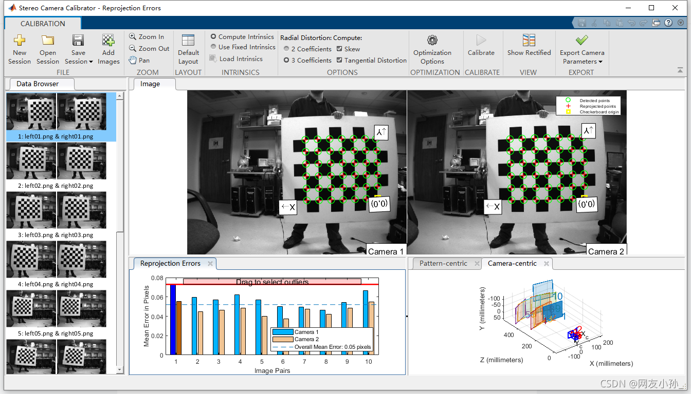

下图为ros2标定程序

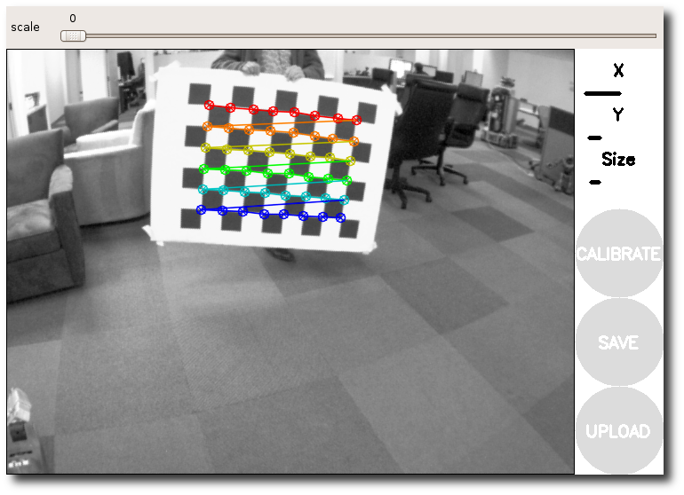


## 4. PnP：从目标的图像点获得其相对相机的姿态

> **学习层级**
>
> - 必须掌握：PnP 需要已知的目标三维模型点、对应二维像素点和相机参数。
> - 需要理解：PnP 输出的 `rvec/tvec` 表示目标到相机的变换，需验证而不能盲信。
> - 暂不要求：推导所有求解算法或实现多目标姿态筛选器。

目标检测回答“图像里哪里有目标”；PnP 回答“如果这些图像点来自一个已知尺寸的目标，它相对相机处于什么位置和姿态”。

### 4.1.1 PnP 的直观原理

把目标看成一个带有已知尺寸的三维模型。例如，装甲板模型中四个角点在目标坐标系中的位置是已知的。相机拍摄目标后，检测器得到这些角点在图像中的像素位置。PnP 要做的事情是寻找一组旋转和平移，使模型上的每个三维角点经过相机投影后，尽可能落在对应的图像角点附近。

可以把这个过程想成“试姿态再投影”：

1. 假设目标处在某个位置和姿态；
2. 根据相机内参和畸变模型，把三维模型投影到图像上；
3. 比较投影点与实际检测点的距离，这个距离就是重投影误差；
4. 调整姿态，寻找误差较小且符合物理约束的结果。

因此，PnP 的输出是一组描述“目标如何位于相机前方”的姿态参数。点的位置分布、目标尺寸、相机标定质量和点的对应顺序都会影响结果。本文更侧重于solvepnp的使用而不是pnp的原理，对pnp原理比较感兴趣的同学可以查看这个链接【如何通过一张图片知道对方位置？PnP位姿求解动画详解】https://www.bilibili.com/video/BV1Kapi6qEM2?vd_source=21c88c1b039f17f62450f52c71d0c27e

### 4.2 `cv::solvePnP` 的输入与输出

PnP 使用目标坐标系 `T` 中的三维点 `p_T`，以及这些点对应的像素坐标。通过内参和畸变模型寻找旋转 `R_CT` 与平移 `t_CT`，使投影结果贴近图像观测：

```text
p_C = R_CT p_T + t_CT

目标模型的 3D 点 + 图像中的对应 2D 点 + K + 畸变参数
                         -> solvePnP
                         -> rvec, tvec
```

OpenCV 的 `solvePnP` 返回的 `rvec`、`tvec` 描述目标坐标系到相机坐标系的变换 `T_CT`。因此 `tvec` 是目标坐标系原点在相机坐标系中的位置，单位与 `objectPoints` 一致。若目标模型用毫米，输出平移也是毫米。

其常用接口可以概括为：

```cpp
bool cv::solvePnP(
    InputArray objectPoints,
    InputArray imagePoints,
    InputArray cameraMatrix,
    InputArray distCoeffs,
    OutputArray rvec,
    OutputArray tvec,
    bool useExtrinsicGuess = false,
    int flags = SOLVEPNP_ITERATIVE);
```
各参数含义如下：

| 参数 | 输入/输出 | 含义与要求 |
| --- | --- | --- |
| `objectPoints` | 输入 | 目标坐标系中的 3D 点，例如装甲板四角；通常使用 `Point3f` 或 `Point3d`，长度单位由读者自行统一 |
| `imagePoints` | 输入 | 与 3D 点一一对应的图像像素点；数量和顺序必须与 `objectPoints` 完全一致 |
| `cameraMatrix` | 输入 | 3×3 相机内参矩阵 `K`，通常包含 `fx、fy、cx、cy` |
| `distCoeffs` | 输入 | 相机畸变系数；使用原始畸变像素时应传入对应标定结果 |
| `rvec` | 输出 | Rodrigues 旋转向量，表示目标坐标系如何旋转到相机坐标系；不是三个欧拉角 |
| `tvec` | 输出 | 目标坐标系原点在相机坐标系中的位置，单位与 `objectPoints` 相同 |
| `useExtrinsicGuess` | 输入 | 是否把已有的 `rvec/tvec` 作为迭代初值；只有确实提供了合理初值时才使用 |
| `flags` | 输入 | 指定求解方法，例如 `SOLVEPNP_ITERATIVE`、`SOLVEPNP_EPNP` 或 `SOLVEPNP_IPPE` |

在大多数常用方法中，至少需要四组质量可靠的 3D-2D 对应点；具体最低数量和点的几何限制取决于 `flags`。平面矩形目标应特别注意共面点可能产生多个姿态候选，不能只检查返回值是否为 `true`。


### 4.2.1 从灯条检测结果构造 `imagePoints`

上周的练习中我们能够检测到装甲板的灯条并用旋转矩形框出灯条，这次我们要在此基础上做出一些升级。solvepnp 需要输入几个稳定、顺序明确的图像点即imagePoints。一个最简单，最直接，最不绕弯子的办法是取每根灯条旋转矩形的上边中点和下边中点，作为这根灯条的两个端点。再按统一顺序排列四点，例如：

```text
左灯条上端、右灯条上端、右灯条下端、左灯条下端
```

以上方案的优点是简单，计算量小。但是旋转矩形中点并不一定对应着灯条实际的端点，而且这种偏差会随视角、环境亮度、阈值和遮挡等环境影响而变化，这种偏差会进一步影响 solvePnP 的位姿估计。那么有没有更高级的做法呢？有的兄弟有的，以下是更复杂，更精细的传统视觉角点提取方案：

我们可以在灯条旋转矩形周围扩展一个小 ROI：先计算 ROI 的平均亮度，并对亮度图做归一化，减弱整体明暗差异；再用亮度质心估计灯条中心，用 PCA（主成分分析）估计灯条的主轴方向；沿主轴方向布置多条平行搜索线，寻找亮度突变的位置，得到多个端点候选并求平均，作为修正后的端点。若 ROI 太暗、过曝、被遮挡或无法稳定找到亮度边界，就回退到简单方案。

以上方法可以降低角点提取带来的重投影误差，但是需要调节的参数较多且受光照环境影响较大，这是传统视觉的通病：在训练或测试时能用的一套参数在比赛场地上却效果不佳，往往需要根据比赛场地环境来调节参数，对于准备时间有限的RMer来说还是太吃操作了。那么有没有那种不需要调节大量参数，光照环境影响小，在赛场上不调参就能直接用的方法呢？有的兄弟有的，以下是现代RM常用做法，深度学习提取角点方案：

如果有看过或者了解过开源自瞄的同学会发现：25-26年的大部分开源自瞄方案都采用了YOLO识别和提取装甲板角点。深度学习方案通常先收集开源数据集和自己拍摄的装甲板图像，覆盖不同环境，并为每个目标标注边界框或四个灯条端点/关键点。然后结合YOLO预训练权重与模型训练代码进行训练，得到装甲板模型的权重即可投入使用。YOLO是一类单阶段目标检测网络，它把整张图像输入网络，输出目标类别、位置和置信度。这种方案速度快，效果好，看抗干扰能力强且在训练完成后不需要调节参数，已成为现代自喵的主流选择。

深度学习方案虽然用起来很轮椅但是自己训练模型是非常困难的，很少有战队会自己训练，大家一般都是使用几个强队开源的模型。首先想要训练出一个能用的模型需要大量的数据（2-3万张装甲板图片），这使得数据集的获取和标注变得非常费时，困难。其次训练这么大数据量的数据集对算力要求很高（笔记本电脑肯定不行）。还有yolo自己的训练框架和预训练模型训练出来的装甲板模型效果可能不尽如人意，需要我们自己对yolo各个模块进行修改，这使得每次训练出来的模型结果不可控，像“炼丹”一样。因此本次培训主要介绍的是传统视觉，即opencv方案。对深度学习和yolo比较感兴趣的同学可以自行搜索相关内容。


### 4.2.2 用装甲板尺寸构造 `objectPoints`

solvepnp除了需要输入与imagePoints，还需要输入与其物理位置对应的模型点，即objectPoints。objectPoints是物体局部坐标系下n个点的坐标，对于Robomaster来说就是装甲板坐标系下4个灯条端点的坐标。通过仔细查阅RoboMaster的官方规则手册，我们发现小装甲板的宽度为0.135m，灯条长度为0.056m。因此，我们可以将装甲板中心设为目标坐标系原点，令装甲板平面为 `Z_T = 0`，即z=0。并按“左上、右上、右下、左下”排列，则四点为：

```cpp
const std::vector<cv::Point3f> object_points{
  { -w / 2, -h / 2,  0}, //左上
  {  w / 2, -h / 2,  0}, //右上
  {  w / 2,  h / 2,  0}, //右下
  { -w / 2,  h / 2,  0}  //左下
  };
```

取不同的坐标系方向object_points的构造不同，我们这里采用的是下图的装甲板坐标系。你可以根据算法需要使用不同的坐标系方向，但无论选择什么坐标系方向，使用solvepnp必须保持输入的图像点与模型点一一对应。

```text
imagePoints:  左上 -> 右上 -> 右下 -> 左下
objectPoints: 左上 -> 右上 -> 右下 -> 左下
```
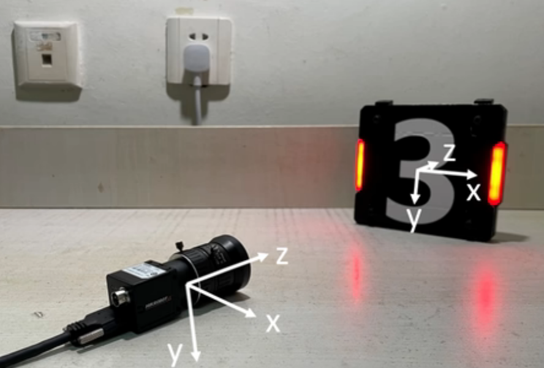


### 4.3 角点、内参和畸变如何配合

用于 PnP 的图像点可以是原始畸变图像中的像素点，此时要把相机内参和对应畸变参数传给求解器；也可以先将点去畸变到理想像素坐标，再按去畸变后的坐标模型调用。关键是不能把“已去畸变的点”再当作原始点重复校正。

如果图像被缩放、裁剪、旋转或镜像，像素坐标定义已变化，内参也要相应调整。直接复用原分辨率的 `K` 是 PnP 常见错误来源之一。

### 4.4 求解结果必须验证

```cpp
cv::Mat rvec, tvec;
bool ok = cv::solvePnP(
    object_points, image_points,
    camera_matrix, dist_coeffs,
    rvec, tvec, false, cv::SOLVEPNP_ITERATIVE);
```

`ok == true` 表示求解器返回成功，但是不等于结果一定正确。

一项重要检查是重投影：用求出的姿态把模型角点投回图像，比较预测像素和实际检测像素的距离。误差太大时，应优先检查目标尺寸、点顺序、内参、畸变、图像缩放和角点质量。还要检查目标是否在相机前方、距离是否合理，以及连续帧结果是否突然跳变。

平面矩形的角点共面，特定视角下可能出现多个看起来都合理的姿态。选解时应结合目标在相机前方、重投影误差、姿态连续性和业务约束，而不是只依赖一次求解返回值。

### 4.5 常见 `solvePnP` 方法如何选择

OpenCV 提供多种 PnP 求解方法，它们不是“精度从低到高”的简单排序，而是针对不同点数、初值和目标几何设计：

| `flags` | 直观理解 | 常见用途与注意点 |
| --- | --- | --- |
| `SOLVEPNP_ITERATIVE` | 从初始姿态出发，通过迭代减小重投影误差 | 通用、常见；对点质量和初值较敏感 |
| `SOLVEPNP_EPNP` | 用较快的非迭代方法求一个姿态 | 点数较多时可作为快速求解或初值，仍需验证误差 |
| `SOLVEPNP_P3P` / `SOLVEPNP_AP3P` | 用少量点求解可能的姿态候选 | 算法基于少量点并可能产生多个解；通过 `solvePnP` 使用时通常准备 4 个点来完成解的筛选 |
| `SOLVEPNP_IPPE` | 针对共面点设计，考虑平面目标的多解情况 | 平面矩形或标定板类目标；应检查候选姿态和重投影误差（RM自瞄常用此方法） |
| `SOLVEPNP_IPPE_SQUARE` | 针对严格正方形和规定点序的特殊版本 | 普通长方形不能直接套用，点顺序必须满足 OpenCV 要求 |
| `SOLVEPNP_SQPNP` | 求取稳定的全局最优或近似最优解 | 适合进一步学习，仍需结合数据质量验证 |

入门阶段不必掌握所有算法。对 RM 装甲板，更重要的是先保证目标尺寸正确、四个角点顺序稳定、相机参数匹配，并用重投影误差和连续帧一致性验证结果，再考虑更换求解方法。

### 4.6 从相机坐标到云台/世界坐标

PnP 得到的是目标相对相机的姿态。若要给云台方向，需要继续做坐标变换。设目标中心 `p_T` 在目标系中的坐标，PnP 得到 `T_CT`，相机相对云台基座的外参为 `T_GC`，则：

```text
p_G = T_GC T_CT p_T
```

若相机位姿相对世界已知，还可以继续变换：

```text
p_W = T_WG T_GC T_CT p_T
```

这条链清楚地区分了三个问题：PnP 把目标模型放到相机系；安装外参把相机系连接到云台系；机器人自身定位或场地标定再把云台系连接到世界系。普通单目相机做局部云台跟踪不一定需要世界坐标系；当任务需要把目标放在场地地图中、跨机器人共享位置或融合其他传感器时，世界坐标系才变得重要。

### 4.7 相机与云台之间的外参怎样获得

相机标定得到的内参和畸变描述“相机怎样成像”；它们不告诉我们相机安装在云台的什么位置、朝向哪里。外参描述的是相机坐标系与云台旋转中心的刚性变换，即相机坐标系需要旋转（旋转矩阵G）和平移（平移矩阵t）多少才能变换到云台旋转中心（yaw轴云台和pitch轴云台的交点）。t为1×3矩阵，三个值分别代表x，y，z的偏移量。这部分我们可以通过拷打机械组同学轻松获取。而G为3×3矩阵，手动计算起来非常困难，所以我们需要进行手眼标定。手眼标定同时记录相机拍摄的标定板照片与主控回传的yaw、pitch和roll数据并进行计算，最终能得到G和t。需要注意，在做手眼标定时，应该保证机器人的底盘
### 4.8 从空间位置到 yaw 与 pitch

如果云台坐标按 `X_G` 向右、`Y_G` 向下、`Z_G` 向前约定，目标方向角可以写为：

```text
yaw   = atan2(X_G, Z_G)
pitch = atan2(-Y_G, sqrt(X_G^2 + Z_G^2))
```

这里 pitch 正方向定义为抬头，因此 `Y_G` 向下时取负。这个公式得到的是几何目标方向，不一定就是下位机需要的最终指令：还要考虑当前云台角度、机械零位、角度单位、控制模式、限位和延迟。若协议约定的轴向或正方向不同，符号也要相应改变。

相机安装在会动的云台上时，要用当前云台姿态建立相机与云台基座之间的动态变换。用于图像帧的云台角度应尽量与该帧的采集时刻对应；拿过期角度变换当前图像，会引入额外定位误差。

在 RM 中的应用：当装甲板尺寸已知、角点检测稳定时，PnP 可以估计装甲板中心相对相机的距离和方向。之后，系统把这个结果通过相机安装关系变换到云台所使用的坐标，再结合云台当前姿态形成控制目标。若只需要粗略二维跟随，也可以直接使用像素误差；但那不是三维距离或绝对空间位置。

## 5. 跟踪控制：把几何结果变成可执行命令

PnP 或二维检测得到的仍是测量结果，并不能直接输出控制指令。接下来介绍的是控制层，控制层要决定“目标应该在什么方向”“当前云台与目标差多少”“命令变化多快”，还要设置死区、限幅和失效策略。

### 5.1 二维图像误差与三维角度不是一回事

对图像中心 `(u_c, v_c)` 和检测中心 `(u_t, v_t)`，可定义像素误差：

```text
e_u = u_t - u_c
e_v = v_t - v_c
```

`e_u`、`e_v` 的单位是像素。若目标在图像中心右侧，`e_u > 0`；若在中心下方，`e_v > 0`。它们可以用于二维跟随控制，但不能直接称为 yaw/pitch 角度，也不能直接当作三维位置。目标深度不同，同样的像素偏差对应的实际角度通常不同。


若使用 PnP，则可由相机坐标中的目标位置和相机内参求几何方向角；再经相机到云台的外参变换，得到云台参考下的目标方向。两种方式解决的问题层次不同：像素误差简单直接，PnP 路径提供与已知目标尺寸相关的三维位置估计。

### 5.2 比例控制、死区与限幅

最简单的比例控制会按误差大小生成命令：

```text
command = Kp * error
```

若使用像素误差，`Kp` 的单位必须把“像素”映射到下位机的控制量；若使用角度误差，`Kp` 则对应角度到角速度或角度增量的映射。不能把一个项目里调好的 `Kp` 不经单位核对就搬到另一种协议或分辨率上。

实际系统通常还需要：

- **死区**：误差小于阈值时不再调整，避免检测噪声引起云台持续抖动；
- **限幅**：限制单次命令或角速度，避免大误差时突然快速转动；
- **方向验证**：用低速、小幅命令确认 yaw 和 pitch 的正方向；
- **失效处理**：没有可信目标时，不继续使用旧误差。

若 `Kp` 太大，云台可能来回摆动；太小则跟随迟缓。调试时应先确认符号正确，再从小增益逐步增加，并分别测试水平、垂直方向。不要同时更换相机参数、坐标轴符号和控制增益，否则无法判断问题来自哪一层。

### 5.3 PID：根据误差生成控制量

比例控制只看当前误差。对于存在惯性、延迟或持续偏差的系统，可以进一步使用 PID。PID 是比例（Proportional）、积分（Integral）和微分（Derivative）三种作用的组合：比例根据当前误差作出响应；积分累加一段时间内的误差，用于消除持续存在的偏差；微分观察误差变化趋势，用于抑制过快变化、改善过渡过程。PID 是一种常见控制方法，不是任何场景下都必须使用的“万能算法”。

设目标量为 `r(t)`，测量量为 `y(t)`，误差为 `e(t) = r(t) - y(t)`，连续形式可写为：

```text
u(t) = Kp * e(t) + Ki * integral(e(t)) + Kd * de(t)/dt
```

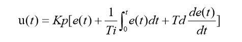

其中 `u(t)` 是控制器输出，`Kp`、`Ki`、`Kd` 分别是比例、积分、微分系数。这里的“测量量”必须来自真实传感器或视觉观测；若系统没有测量当前状态，仅有目标设定值，就无法根据实际误差实现反馈 PID。

计算机按固定周期 `dt` 运行时，常见离散形式为：

```text
P = Kp * e[k]
I = I + Ki * e[k] * dt
D = Kd * (e[k] - e[k-1]) / dt
u[k] = P + I + D
```

`k` 表示当前采样时刻。真实程序要使用实际或稳定的采样周期；若帧率变化明显却仍假设 `dt` 固定，积分和微分的效果都会改变。微分直接作用于测量噪声时容易放大抖动，工程中常对微分项滤波，或对测量值求微分。

#### PI、PD 与 PID

| 类型 | 组成与常见作用 | 需要留意 |
| --- | --- | --- |
| P | 按当前误差立即调整；结构简单，常作为调试起点 | 单独使用通常可能留下稳态偏差；增益过大会振荡 |
| PI | P 提供快速响应，I 累积持续误差 | 积分可能导致超调和积分饱和；目标丢失或输出饱和时要暂停、清除或限制积分 |
| PD | P 响应当前误差，D 根据误差变化趋势提供阻尼 | 不会自动消除持续偏差；D 对噪声敏感，常用于需要更快且稳定响应的场合 |
| PID | 同时使用 P、I、D，兼顾响应、稳态偏差和过渡过程 | 参数相互影响，不能只凭公式断言一定更快或更稳，必须结合系统测量调试 |

积分在系统条件合适、执行器未饱和且控制方向正确时，能够推动稳态误差减小；它不意味着任何系统都必然零误差。输出达到限幅后若继续累积积分，会产生积分饱和，误差反向时还可能长时间无法退出饱和区。常见处理包括积分限幅、输出饱和时停止同方向积分，或采用抗饱和回算。

#### 位置式与增量式

位置式 PID 直接计算当前控制输出 `u[k]`，一种常用离散表达为：

```text
u[k] = Kp * e[k]
     + Ki * dt * sum(e[i], i=0..k)
     + Kd / dt * (e[k] - e[k-1])
```

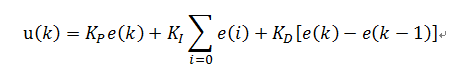

位置式PID是当前系统的实际位置，与你想要达到的预期位置的偏差，进行PID控制

因为有误差积分 ∑e(i)，一直累加，也就是当前的输出u(k)与过去的所有状态都有关系，用到了误差的累加值；（误差e会有误差累加），输出的u(k)对应的是执行机构的实际位置，，一旦控制输出出错(控制对象的当前的状态值出现问题 )，u(k)的大幅变化会引起系统的大幅变化。并且位置式PID在积分项达到饱和时,误差仍然会在积分作用下继续累积，一旦误差开始反向变化，系统需要一定时间从饱和区退出，所以在u(k)达到最大和最小时，要停止积分作用，并且要有积分限幅和输出限幅。所以在使用位置式PID时，一般我们直接使用PD控制

位置式 PID 适用于执行机构不带积分部件的对象，如舵机和平衡小车的直立和温控系统的控制


增量式 PID 计算相邻两次控制输出的变化量 `delta_u[k] = u[k] - u[k-1]`，常见形式为：

```text
delta_u[k] = Kp * (e[k] - e[k-1])
            + Ki * dt * e[k]
            + Kd / dt * (e[k] - 2*e[k-1] + e[k-2])
u[k] = u[k-1] + delta_u[k]
```

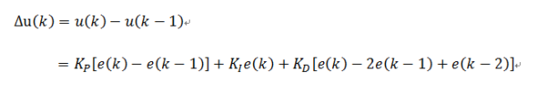

增量式PID根据公式可以很好地看出，一旦确定了 KP、TI  、TD，只要使用前后三次测量值的偏差， 即可由公式求出控制增量。而得出的控制量▲u(k)对应的是近几次位置误差的增量，而不是对应与实际位置的偏差没有误差累加。也就是说，增量式PID中不需要累加。控制增量Δu(k)的确定仅与最近3次的采样值有关，容易通过加权处理获得比较好的控制效果，并且在系统发生问题时，增量式不会严重影响系统的工作

增量型 PID，是对位置型 PID 取增量，这时控制器输出的是相邻两次采样时刻所计算的位置值之差，得到的结果是增量，即在上一次的控制量的基础上需要增加（负值意味减少）控制量。


### 5.4 无目标处理

当目标短暂遮挡或离开画面时，应使控制器进入无目标状态，并按工况需求控制云台停止、保持短时姿态或回到安全位置，不建议一直用最后一次目标位置控制。这是必要的安全保护措施

### 5.5 关于控制器

控制器是整个系统中不可或缺的一环，他根据检测器提供的信息发布指令操控下位机。控制器是算法的执行者，在自瞄系统中控制器控制yaw轴云台和pitch轴云台运动；在导航系统中控制器控制底盘的运动。控制器的设计决定了能否发挥检测器或其他算法的全部能力。pid及其衍生算法广泛应用在机械设备、气动设备 和电子设备，在工业应用中是应用最广泛的算法之一。实际上电控组的同学会更多地用到pid及其衍生算法。在RM的自瞄与导航领域，现在更多使用的是mpc（模型预测控制）算法。对mpc感兴趣的同学可以自行查阅资料。

## 6. 通信协议：把有单位的命令变成可靠字节

上位机发出的指令下位机并不能理解，下位机回传的状态上位机同样不懂。通信协议作为翻译官向下位机解释上位机的指令，向上位机翻译下位机的回传信息，是不可或缺的一环。通信协议通常由算法组同学和电控组同学配合完成，一般是算法组同学提出要求即通信协议应有字段，然后交给电控组同学实现完善通信协议，最终电控组同学交付完整的通信协议。

### 6.1 一帧控制协议应说明什么

常见协议可能包含：

| 字段 | 需要约定的内容 |
| --- | --- |
| 串口配置 | 使用哪个设备端口、波特率、数据位、校验位和停止位 |
| 帧头 | 用什么字节标记一帧开始 |
| 长度/类型 | 如何判断帧长度以及消息类别 |
| 目标有效位 | 如何区分当前目标有效和目标丢失 |
| yaw、pitch | 是绝对角还是角度增量；单位是弧度、角度还是编码器计数；正方向如何定义 |
| 时间或序号 | 如何识别旧命令、丢帧或乱序（如协议需要） |
| 校验字段 | 如何发现传输中的字节错误 |
| 帧尾 | 是否有结束标志，以及接收端如何重新同步 |

下图中左侧为算法组同学提出的要求，右侧为电控组交付的部分通信协议

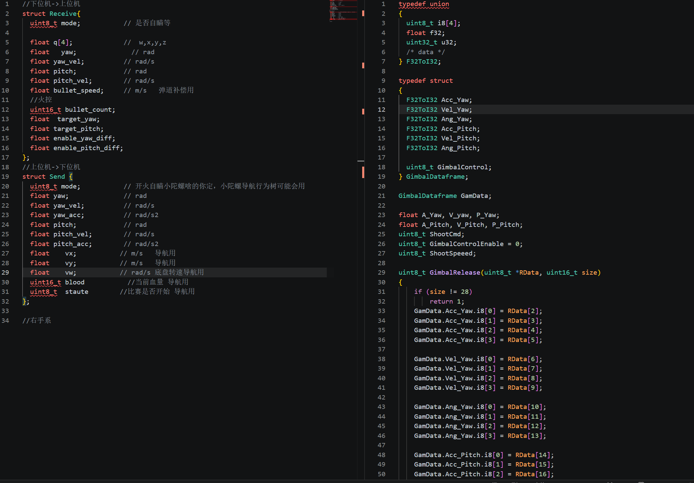


### 6.2 显式序列化，不要直接发送任意结构体内存

不同编译器可能为结构体插入填充字节；整数的字节顺序也可能不同。直接把 C++ 结构体的内存写进串口，可能在另一端得到错位或错误数据。应按协议明确地逐字段编码和解码，并明确浮点或定点数格式、端序、长度和校验。

```text
逻辑命令：valid, yaw, pitch
       ↓ 单位换算与范围限制
协议字段：帧头 | 标志位 | yaw整数 | pitch整数 | 校验
       ↓ 串口发送
下位机按同一协议解析并检查
```

若协议使用“角度乘以 100”存成整数，换算应发生在通信适配层，并在协议文档中明确。不要让检测或坐标变换模块悄悄输出一个下位机专用的缩放数字。

### 6.3 逐层验证通信与安全状态

调试串口时先绕开视觉算法，发送固定且安全的测试命令，确认端口、波特率、帧头、字段和校验都正确；再验证 yaw、pitch 各自的正方向和限位；最后连接实时目标结果。目标无效、串口断开或数据超时的行为必须事先约定，通常应让下位机进入可预测的安全状态。在实际调车中，遥控器上往往会有某一个按键按下后整车失去使能，这是我们测试时的最后一道保障，当出现云台后其他地方失控时一定要关闭全车使能然后排查问题。

在 RM 中的应用：视觉模块可以输出“目标有效、目标角度、时间戳”等语义明确的数据；串口层负责按约定转成字节，下位机再决定如何驱动电机。这样即使换相机、换检测算法，也不必把协议解析混进图像处理代码。

### 6.4 在虚拟机中连接相机和云台

将电脑上的usb设备连接到虚拟机步骤如下图所示，在虚拟机的可移动设备选项中选择想要接入的设备然后选择连接即可

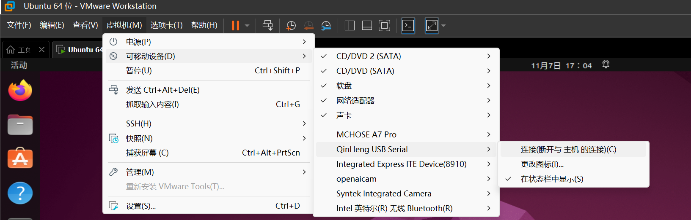

云台控制器连接成功后，Linux 通常会为 USB 转串口设备创建类似 `/dev/ttyUSB0` 或 `/dev/ttyACM0` 的设备节点。先用 `ls /dev/ttyUSB* /dev/ttyACM* ` 查看实际名称。

如果当前用户没有访问该设备的权限，可以临时执行：

```bash
sudo chmod 666 /dev/ttyUSB0   #USB0换为实际的串口名
```

这条命令的含义是：以管理员权限把指定设备文件的读写权限设置为“所有用户可读写”。它只对当前设备节点有效；云台重新插拔、系统重启或设备编号改变后，权限可能恢复，甚至路径可能变成 `/dev/ttyUSB1`。像为某个设备设置永久权限应将用户加入设备所属的用户组（常见为 `dialout`），或编写 udev 规则为设备建立稳定名称并设置权限；修改用户组后通常需要重新登录。

### 6.5 `gimbal` 云台接口与使用方法

仓库中的gimbal是我已经封装好的云台控制库，

| 接口 | 作用 | 注意事项 |
| --- | --- | --- |
| `gimbal::Gimbal(device, baudRate, periodMs)` | 打开串口并启动周期发送线程 | 默认设备为 `/dev/ttyUSB0`，波特率为 `115200`，发送周期为 `10 ms`；波特率值必须与下位机约定的一致 |
| `publish( doubule yaw, double pitch)` | 发布 yaw、pitch 目标角度 | yaw `0~180°`、pitch `0~90°` 限幅，传入值是角度 |
| `publish(Position)` | 用结构体发布目标角度 | 适合在程序中同时传递两个轴的目标 |
| `target()` | 读取最近一次发布的目标 | 主要用于调试或查看当前待发送值 |
| `stop()` | 停止发送线程并关闭串口 | 结束程序前应主动停止视觉循环和云台 |

以下是一个测试用例

```cpp
#include "gimbal.hpp"

int main() {
    gimbal::Gimbal gimbal("/dev/ttyUSB0", 115200, 10);

    // 控制yaw云台移动到90°的位置，pitch云台移动到45°的位置
    gimbal.publish(90.0, 45.0);
    gimbal.stop();
}
```


编译使用 `gimbal` 时，需要把该目录加入工程并链接它依赖的串口库，例如：

```cmake
add_subdirectory(gimbal)
target_link_libraries(your_target PRIVATE gimbal)
```

建议在接入视觉程序之前先发送一个数值较小的固定角度，确认下位机云台控制的坐标系是如何约定的；再用缓慢变化的角度测试两个轴；最后才把视觉计算出的角度接入 `publish()`。


## 7. END

文中有不少深入内容需要自己去学习和探索，后续可继续学习yolo、PnP 多解处理、相机与云台手眼标定、IMU 姿态融合、卡尔曼滤波、mpc、弹道补偿、延迟补偿、双目或深度感知及多传感器定位。算法组最重要的特质是学会尊重知识，懂得检索，能够独立解决问题。算法组总是在等待，等待机械组出车，等待电控组调车，更多的是等待自己理解和掌握算法的内核。

### 参考资料

- 《视觉 SLAM 十四讲》：相机模型、坐标变换、相机标定等基础内容。
- OpenCV 官方 `calib3d` 文档：[Camera Calibration and 3D Reconstruction](https://docs.opencv.org/4.x/d9/d0c/group__calib3d.html)，用于核对 `solvePnP`、`projectPoints`、标定参数和各类 `SOLVEPNP_*` 方法的接口与限制。
- OpenCV 官方教程：[Camera calibration With OpenCV](https://docs.opencv.org/4.x/dc/dbb/tutorial_py_calibration.html)，用于理解标定板、内参、畸变和重投影误差。
- Lepetit、Moreno-Noguer、Fua，*EPnP: An Accurate O(n) Solution to the PnP Problem*，International Journal of Computer Vision, 2009，DOI：[10.1007/s11263-008-0152-6](https://doi.org/10.1007/s11263-008-0152-6)，用于理解 EPNP 的问题背景和快速求解思想。
- Terzakis、Lourakis，*A Consistently Fast and Globally Optimal Solution to the Perspective-n-Point Problem*，ECCV 2020，用于了解 SQPnP 的设计目标；入门阶段不要求推导其内部算法。
- James Diebel，*Representing Attitude: Euler Angles, Unit Quaternions, and Rotation Vectors*，Stanford University, 2006，用于理解欧拉角、旋转向量和单位四元数之间的区别。
- ROS 2 文档：[Quaternion Fundamentals](https://docs.ros.org/en/rolling/Tutorials/Intermediate/Tf2/Quaternion-Fundamentals.html)，用于参考四元数的姿态组合、消息表示和坐标变换约定。

